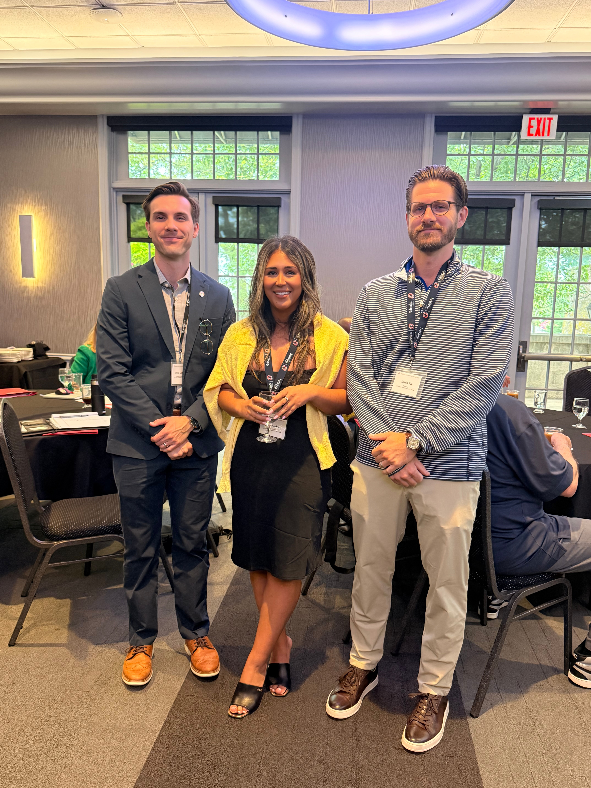
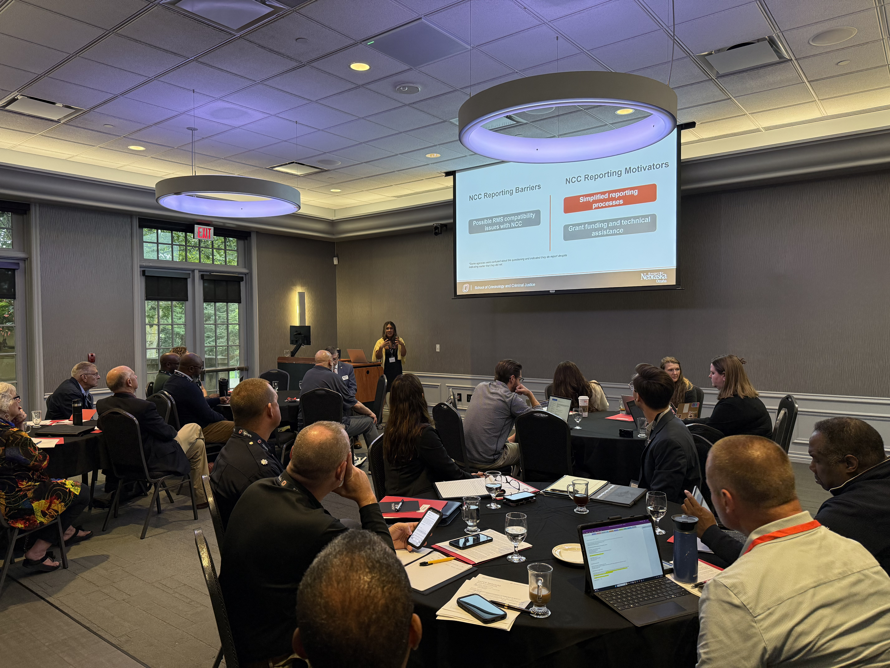
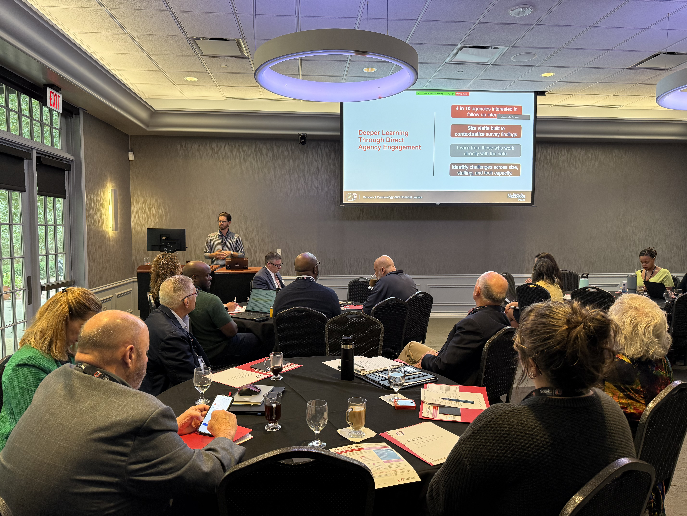
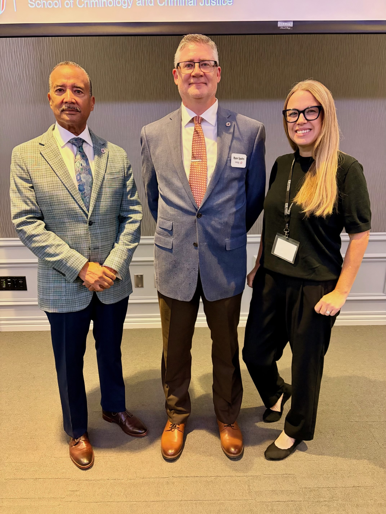
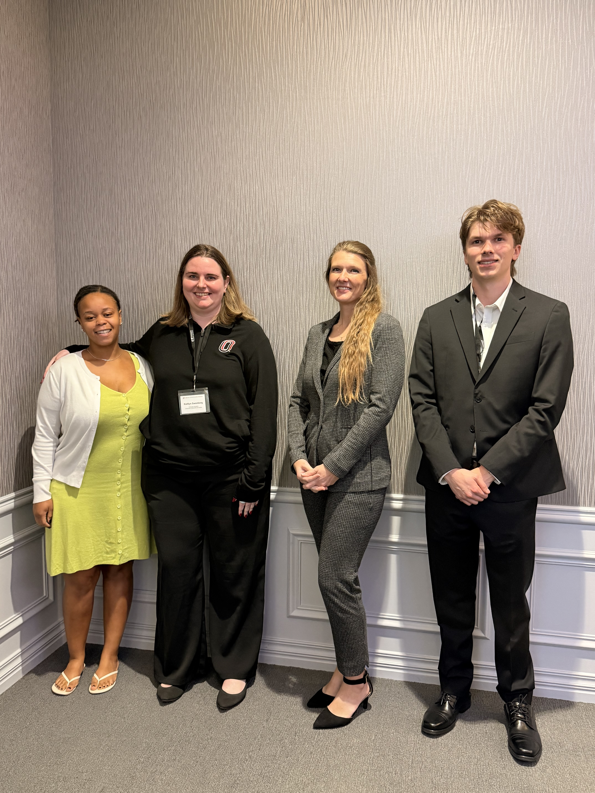

On September 22, 2026, the SAFER (Safety Analytics for Evidence-Based Roadways) Nebraska team at the University of Nebraska at Omaha hosted an in-person Advisory Board meeting, bringing together law enforcement, judicial, community, state, and academic partners from across Nebraska, along with a representative from Connecticut's Racial Profiling Prohibition Advisory Board.

SAFER Nebraska is a multi-phase research initiative conducted in partnership with the Nebraska Department of Transportation and the Nebraska Commission on Law Enforcement and Criminal Justice. The project focuses on strengthening how traffic stop data are collected, reported, analyzed, and used across Nebraska to support more consistent and informed practices.

The meeting provided an opportunity to share findings from the project's Phase 2 statewide law enforcement survey and training initiative and to discuss priorities for Phase 3 implementation. Advisory Board members offered perspectives on agency engagement, data collection and reporting, community engagement, and the development of rules and regulations. These discussions helped identify priorities for moving the project forward while considering the needs and experiences of agencies and communities across the state.

As SAFER Nebraska enters Phase 3, the research team will work more directly with law enforcement agencies through site visits and assessments of existing traffic stop data practices. This work will help identify reporting challenges, better understand agency needs, and inform future recommendations, training, and technical assistance.

The Advisory Board meeting marked an important step in connecting research with practice and strengthening collaboration among the partners working to improve traffic stop data practices across Nebraska.

