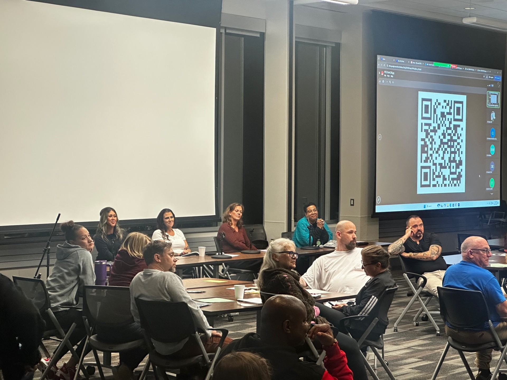
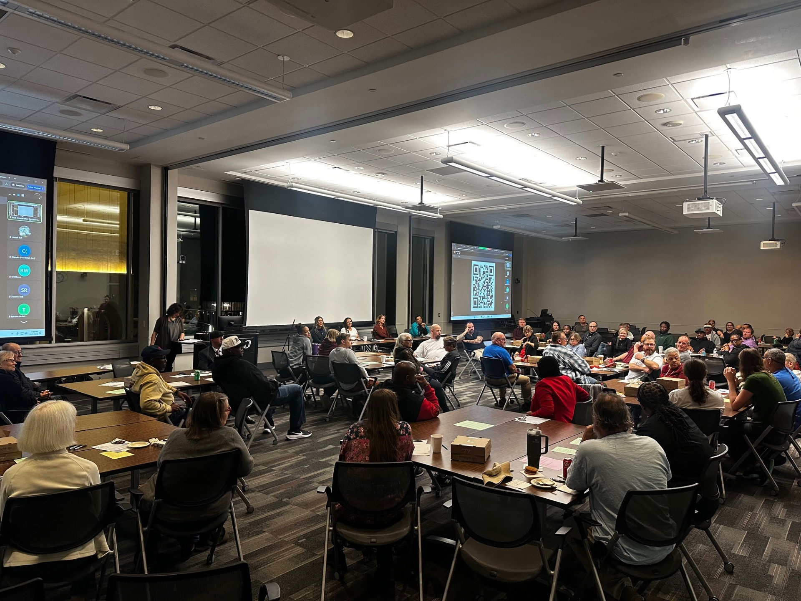

On November 2, 2026, the [Transforming, Renewing, Achieving, and Connecting (TRAC)](https://www.unomaha.edu/college-of-public-affairs-and-community-service/criminology-and-criminal-justice/undergraduate-programs/trac.php) Student Organization and the Omaha Alternatives to Violence Project hosted the What Happens After Prison? Symposium at the University of Nebraska at Omaha’s Community Engagement Center. Supported by the UNO Service Learning Academy, the TRAC program, and the School of Criminology and Criminal Justice, the event drew more than 60 attendees, including representatives from the Nebraska Department of Correctional Services, community corrections professionals, individuals with lived experience, researchers, practitioners, and advocates.

The symposium focused on Post-Incarceration Syndrome and the lasting psychological, emotional, and social effects of incarceration. Moderated by Rachael Jensen, Executive Director of Durango Advancement & Support Hub, the panel featured Dr. Sadaf Hashimi, Assistant Professor of Criminology and Criminal Justice and TRAC Program Coordinator; Amy Severe, a family and community advocate; Carla Walker, a formerly incarcerated military veteran and community supporter; and Keri Wayne-Browne, Program Specialist at Wellbeing & Equity Innovations. Panelists explored how experiences and coping strategies developed during incarceration can shape individuals’ adjustment to life after release, including their relationships, sense of identity, family connections, and community reintegration.

Following the panel, attendees participated in interactive small-group discussions examining reentry scenarios and strategies to better support individuals and families affected by incarceration. The symposium brought together lived experience, research, and practice to foster meaningful dialogue and explore how correctional systems and communities can more effectively address the challenges of reentry.

